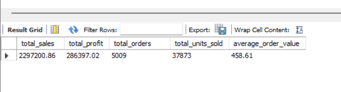
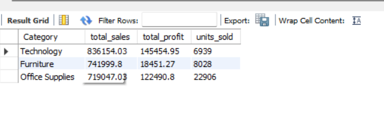
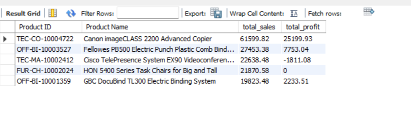
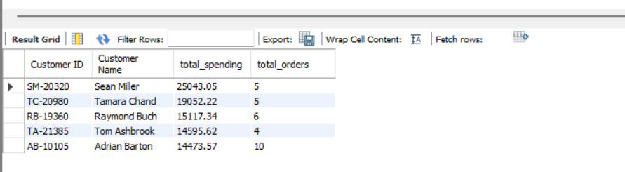
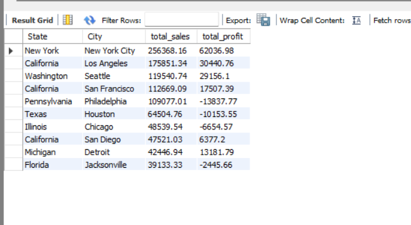
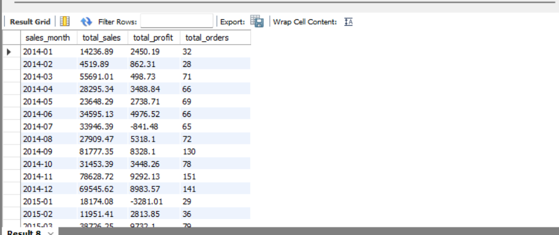

# Sales Data Analysis Using SQL and MySQL

## Overview

This project analyzes the Superstore retail dataset using MySQL.
It examines sales, profitability, customer spending, product performance,
city performance, and monthly sales trends.

## Tools

- MySQL 8
- MySQL Workbench
- Git and GitHub

## Dataset

- Source: https://www.kaggle.com/datasets/vivek468/superstore-dataset-final
- Records: 9,994
- Columns: 21
- Each record represents a product line within an order.

The original CSV and a UTF-8 copy are included in the data folder.
A SQL import script is provided to reproduce the complete data load.

## Business Questions

1. What are total sales, profit, orders, units sold, and average order value?
2. Which categories generate the most sales and profit?
3. Which five products generate the most sales?
4. Which five customers spend the most?
5. Which cities generate the most sales?
6. How do sales and profit change each month?

## Data Preparation

- Loaded and verified all 9,994 source records.
- Checked Row IDs for duplicates.
- Created a separate clean table using SELECT DISTINCT.
- Checked essential fields for missing values.
- Checked order-date conversion using STR_TO_DATE.
- Preserved the source data separately from the clean table.

## Key Findings

- Total sales were 2,297,200.86.
- Canon imageCLASS 2200 Advanced Copier led product sales at 61,599.82.
- Sean Miller was the highest-spending customer at 25,043.05.
- New York City led city sales at 256,368.16.
- Philadelphia generated sales of 109,077.01 but recorded a loss
  of 13,837.77, showing that high sales do not always mean high profit.

These findings suggest reviewing the products and discounts associated
with losses before recommending changes.

## How to Run

Use a fresh MySQL database environment and execute these scripts in order:

1. sql/01_database_setup.sql
2. sql/01b_import_sales.sql
3. sql/02_data_cleaning.sql
4. sql/03_sales_analysis.sql

Run the import script once. It creates and populates sales_raw_complete.
The cleaning script rebuilds sales_clean from that complete source table.

Verify that the clean table contains 9,994 unique Row IDs and total sales
of 2,297,200.86.

## Results

Query result screenshots are available in the screenshots folder.

## SQL Skills Demonstrated

Aggregation, GROUP BY, ORDER BY, DISTINCT, NULL checks,
date conversion, date formatting, and calculated metrics.

## Limitations

This is a descriptive analysis of a sample historical dataset.
It does not predict future sales or establish the causes of losses.